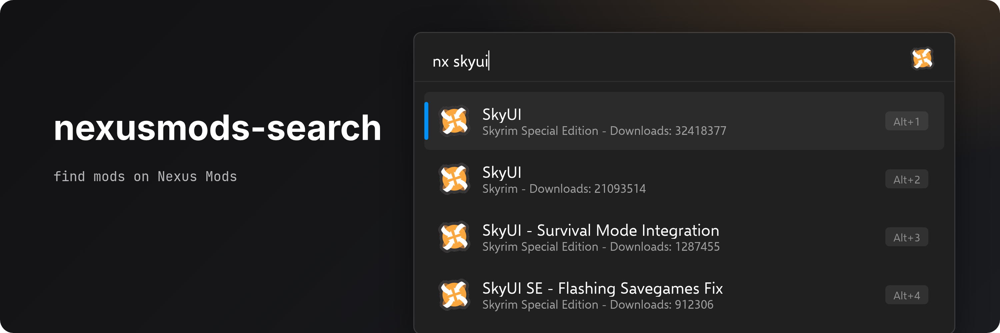

<!-- generated by readwright from docs/README.md.j2; edit the template, not this file -->


# Nexusmods-Search

Search mods on nexusmods.com from Flow Launcher.

[](https://github.com/Garulf/Nexusmods-Search/actions/workflows/tests.yml) [](https://github.com/Garulf/Nexusmods-Search/releases/latest)

[](https://www.buymeacoffee.com/garulf) [](https://github.com/sponsors/Garulf)

> [!WARNING]
> Mod search is not working right now. The search service on `search.nexusmods.com` that this
> plugin queries no longer answers, so searches show a "Nexus Mods search failed" result.
> Listing and picking games still works. See [#2](https://github.com/Garulf/Nexusmods-Search/issues/2) and [#3](https://github.com/Garulf/Nexusmods-Search/issues/3).

## Features

* **Search Nexus Mods from the launcher.** Results show the game and download count.
* **Filter by game.** Narrow a search to one game, picked from the full Nexus Mods games list.
* **Straight to the mod page.** `Enter` opens the mod on nexusmods.com in your browser.

## Usage

Type `nx` followed by a mod name, then press `Enter` to open its page:

```
nx skyui
```


| Query | Result |
| --- | --- |
| `nx <mod>` | Mods matching the name, across every game |
| `nx :` | Every game on Nexus Mods |
| `nx <game>:` | Games whose name matches, e.g. `nx skyrim:` |
| `nx <domain>:<mod>` | Mods for one game only, e.g. `nx skyrimspecialedition:skyui` |

### Filter by game

Type part of a game's name followed by `:` and pick the game. Selecting it fills in the filter:


Then type the mod name after the `:`:


## Installation

### Flow Launcher

In Flow Launcher, type:

```
pm install nexusmods-search
```


### Manual installation

Download `Nexusmods-Search-<version>.zip` from the [latest release](https://github.com/Garulf/Nexusmods-Search/releases/latest) and unzip it into
`%appdata%\FlowLauncher\Plugins`, then restart Flow Launcher.

Pre-releases of the next version are published from the open release PR on the
[releases page](https://github.com/Garulf/Nexusmods-Search/releases) for testing. Flow Launcher won't offer them as updates.

## Requirements

* Flow Launcher 1.17.0 or newer
* Python 3.8 or newer, which Flow Launcher can install for you

## Changelog

See [CHANGELOG.md](CHANGELOG.md) for the full history.
